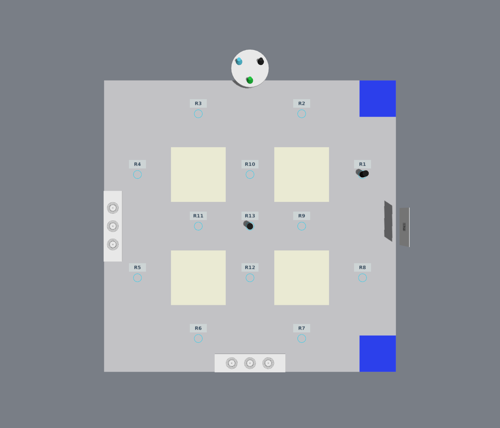

# 2027 工创赛 Gazebo 场地 · R1～R13 障碍抽签

ROS 2 Jazzy / Gazebo Harmonic 的独立仿真场地：2.4 × 2.4 m 场地、工位、真实转盘、物料、二维码、两批码垛初态，以及可复现的 R1～R13 离散障碍物抽签。

**候选编号来自参考图，坐标依据既有场地几何对齐，尚未现场标定，不是官方明确指定的坐标。默认两个障碍仅为开发测试配置。** 本项目是独立仿真工程。

## 模式

|模式|行为|
|---|---|
|random_slots|默认；13 选 2，无放回，不强制可解|
|solvable_slots|按指定导航任务筛选 PATH 组合|
|blocked_slots|筛选主要通路 NO_PATH / DISCONNECTED 组合|
|stress_slots|随机 3～6 个，不筛选通行性|
|manual_slots|精确指定组合，例如 R2 R7 R10|

障碍直径 50 mm、高 100 mm，黑色静态实体，有真实物理碰撞。唯一位置源为包内 config/random_generation.yaml；Gazebo、二维地图、抽签记录与离线 A* 共用该配置。相同版本/配置/种子可复现；不同种子可能抽中相同组合。

## 运行（Ubuntu 24.04 或 WSL2）

先配置 ROS 2 Jazzy、Gazebo Harmonic、colcon、python3-yaml、python3-pil，以及 ros_gz_sim / ros_gz_bridge。接口安装参考 [Gazebo 官方文档](https://gazebosim.org/docs/harmonic/ros_installation/)。

~~~bash
git clone https://github.com/cjh1230/gongchuang-gazebo-field-2027.git
cd gongchuang-gazebo-field-2027/gongchuang_gazebo_ws
source /opt/ros/jazzy/setup.bash
export GC_WORKSPACE="$PWD"
python3 -m pip install --target "$PWD/.python_deps" -r src/gongchuang_gazebo_world/requirements-build.txt
export PYTHONPATH="$PWD/.python_deps:$PYTHONPATH"
colcon build --symlink-install
source install/setup.bash

bash src/gongchuang_gazebo_world/scripts/start.sh random_seeded
~~~

已提交默认生成资源，可以直接启动；修改配置后重新生成：

~~~bash
python3 src/gongchuang_gazebo_world/scripts/generate.py --seed 2027
python3 src/gongchuang_gazebo_world/scripts/generate.py --seed 42 --mode manual_slots --slots R2 R7 R10 --debug-slots
bash src/gongchuang_gazebo_world/scripts/random_scene.sh 2027 auto random_seeded --mode stress_slots
bash src/gongchuang_gazebo_world/scripts/start.sh slots_all
~~~

生成器 --output 可生成独立复现包，避免覆盖默认资源。GUI 可选择 slots_debug、slots_all、central_slots、manual_slots、stress_slots；调试编号没有碰撞。GC_SOFTWARE_RENDER=1 可选择软件渲染。

## 验证和证据

~~~bash
python3 -m unittest discover -s src/gongchuang_gazebo_world/test -p 'test_*.py' -v
colcon test --event-handlers console_direct+
colcon test-result --verbose
python3 src/gongchuang_gazebo_world/scripts/audit_slots.py --output evidence/slots/statistics
python3 src/gongchuang_gazebo_world/test/capture_obstacle_acceptance.py --output evidence/slots/gazebo
~~~

实测 32 项单元/几何测试、2 项 CTest、10 个物理 world 和 6 项转盘/物料状态回归通过。1000 种子覆盖全部 78 种双障碍组合，单次无重复；896 PATH / 104 NO_PATH。13 个候选位分别通过真实圆柱顶面接触验证。

- [验收摘要与坐标表](ACCEPTANCE.md)
- [五种模式、标定和完整使用说明](gongchuang_gazebo_ws/src/gongchuang_gazebo_world/docs/randomization.md)
- [候选编号图](evidence/slots_v5/statistics/candidate_slots.svg)
- [1000 种子统计](evidence/slots_v5/statistics/distribution_1000.json)
- [模型与尺寸来源](gongchuang_gazebo_ws/src/gongchuang_gazebo_world/docs/provenance.md)

固定航向 A* 使用 300 × 300 mm 车体、10 mm 安全裕量、10 mm 跟踪误差和 ±3° 航向包络，路径逐段扫掠。证书只覆盖配置明确指定的导航任务。蓝区名义停靠检测另列，不能当作完整误差预算下的出入保证；详见使用说明。

## 许可证

代码及本项目生成资源使用 [Apache-2.0](LICENSE)，与 ROS 包原有声明一致。外部赛事文件仅作来源引用，未包含或重新授权其原文。本仓库包含精选可复现实验结果，不包含开发电脑的完整运行日志或生产机器人工作区。
